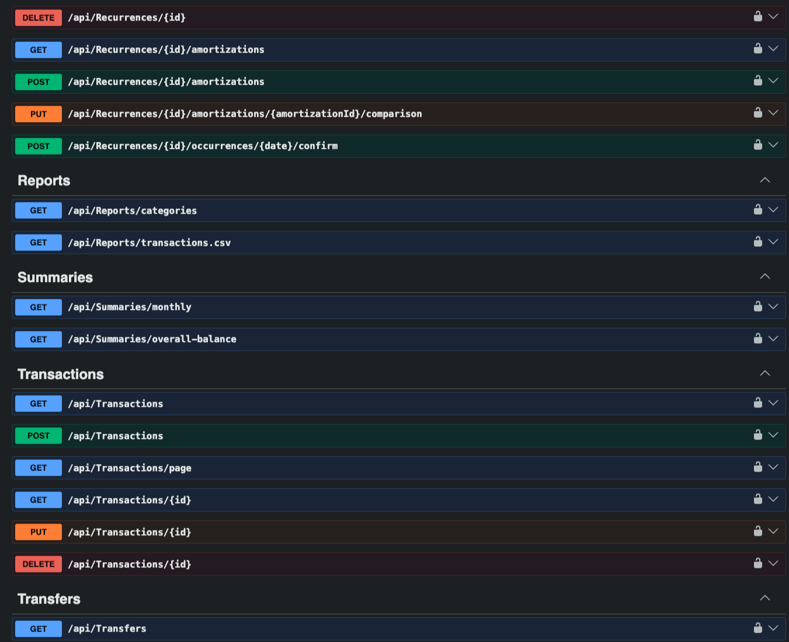

# FinTrack API

API REST em **ASP.NET Core 10** e **PostgreSQL** para o FinTrack. O piloto publicado usa Render para servir a API e o frontend React na mesma origem HTTPS, com o banco no Neon.

[Abrir o FinTrack](https://fintrack.thecodefy.com/) · [Health check](https://fintrack.thecodefy.com/health) · [Repositório do frontend](https://github.com/Padokazzz/fintrack-web) · [Aviso de privacidade](https://fintrack.thecodefy.com/privacy)

## Documentação da API

Com a API local em execução no ambiente de desenvolvimento, abra o [Swagger local](http://localhost:8080/swagger/index.html) para consultar os contratos e testar os endpoints.



## Funcionalidades

- Cadastro com confirmação de senha, verificação por e-mail e recuperação de senha por código.
- Autenticação JWT com renovação por cookie HttpOnly e isolamento dos registros por usuário.
- Contas, cartões vinculados e cálculo de limite usado e disponível.
- Categorias, lançamentos paginados, filtros e transferências com reversão.
- Recorrências mensais com forma de pagamento, confirmação manual, edição de parcelas futuras e agenda de 30 dias.
- Amortizações por valor ou parcelas finais, economia acumulada por dívida e verificação de integridade HMAC-SHA256 do histórico.
- Resumo semanal, limites mensais, relatórios por categoria e exportação CSV.
- Exportação ou exclusão do cadastro mediante confirmação da senha.

## Tecnologias

| Área | Tecnologias |
| --- | --- |
| Linguagem e plataforma | C# · .NET 10 · ASP.NET Core |
| Persistência | Entity Framework Core · PostgreSQL |
| Autenticação | JWT Bearer |
| Validação | FluentValidation |
| Documentação | Swagger · OpenAPI |
| Testes | xUnit · Moq · FluentAssertions |
| Ambiente | Docker · Docker Compose |

## Arquitetura

A solução utiliza uma organização inspirada em Clean Architecture, mantendo regras de negócio e contratos separados dos detalhes de infraestrutura.

```text
FinTrack.Api
FinTrack.Application
FinTrack.Domain
FinTrack.Infrastructure
FinTrack.Tests
```

| Projeto | Responsabilidade |
| --- | --- |
| `FinTrack.Domain` | Entidades, enums e conceitos centrais do domínio. |
| `FinTrack.Application` | Casos de uso, DTOs, interfaces e validadores. |
| `FinTrack.Infrastructure` | Persistência, Entity Framework Core, repositórios e implementações técnicas. |
| `FinTrack.Api` | Endpoints HTTP, middlewares, Swagger e composição da aplicação. |
| `FinTrack.Tests` | Testes automatizados das regras e componentes da aplicação. |

Visão simplificada das dependências:

```text
Api ───────────────> Application ─────> Domain
 │                       ▲
 └────> Infrastructure ──┘
                 │
                 └───────────────────> Domain
```

A camada de domínio não depende dos projetos externos.

## Estrutura do repositório

```text
src/
├── FinTrack.Api/
│   ├── Controllers/
│   ├── Extensions/
│   ├── Middlewares/
│   └── Program.cs
├── FinTrack.Application/
│   ├── Common/
│   ├── DTOs/
│   ├── Interfaces/
│   ├── Services/
│   └── Validators/
├── FinTrack.Domain/
│   ├── Common/
│   ├── Entities/
│   └── Enums/
└── FinTrack.Infrastructure/
    ├── Authentication/
    ├── Data/
    ├── Extensions/
    └── Repositories/
tests/
└── FinTrack.Tests/
```

## Executar localmente

### Pré-requisitos

- .NET SDK 10 ou superior.
- PostgreSQL local ou Docker.
- Git.

Clone o projeto e restaure as dependências:

```bash
git clone https://github.com/Padokazzz/FinTrack.git
cd FinTrack
dotnet restore
```

Configure a conexão com o banco e as opções JWT em `src/FinTrack.Api/appsettings.Development.json`. Você pode partir do arquivo de exemplo, quando disponível:

```bash
cp src/FinTrack.Api/appsettings.Development.example.json src/FinTrack.Api/appsettings.Development.json
```

Exemplo de configuração:

```json
{
  "ConnectionStrings": {
    "DefaultConnection": "Host=localhost;Port=5432;Database=fintrack_db;Username=YOUR_USER;Password=YOUR_PASSWORD"
  },
  "Jwt": {
    "Issuer": "FinTrack.Api",
    "Audience": "FinTrack.Client",
    "Secret": "USE_A_LONG_RANDOM_SECRET_OF_AT_LEAST_32_CHARACTERS",
    "ExpirationMinutes": 60
  }
}
```

Não versione credenciais ou segredos reais. Use variáveis de ambiente ou um gerenciador de segredos em ambientes compartilhados e de produção.

Inicie a API:

```bash
dotnet run --project src/FinTrack.Api/FinTrack.Api.csproj
```

A URL local e a porta são exibidas no terminal. A documentação Swagger fica disponível em `/swagger`.

## Executar com Docker

Na raiz do repositório:

```bash
cp .env.example .env
docker compose up --build
```

A configuração Docker disponibiliza a API e o PostgreSQL. No ambiente descrito pelo projeto, a documentação fica em:

```text
http://localhost:8080/swagger
```

Para encerrar:

```bash
docker compose down
```

Para remover também os volumes persistidos:

```bash
docker compose down -v
```

## Testes

Execute a suíte automatizada:

```bash
dotnet test
```

Ou informe o projeto de testes explicitamente:

```bash
dotnet test tests/FinTrack.Tests/FinTrack.Tests.csproj
```

A suíte unitária cobre serviços da aplicação, validadores e regras de cálculo. O GitHub Actions também sobe a API com um PostgreSQL descartável para validar as migrações e os fluxos de transferência, incluindo reversão, concorrência, validação e isolamento entre usuários.

Para repetir a suíte HTTP localmente, use uma instância de desenvolvimento com um banco descartável e o Swagger habilitado. O teste requer Python 3, cria usuários e grava dados nesse banco.

```bash
FINTRACK_TEST_URL=http://127.0.0.1:8080 python3 tests/integration/test_transfers.py
```

## Principais endpoints

| Recurso | Método e rota |
| --- | --- |
| Cadastro | `POST /api/auth/register` |
| Login | `POST /api/auth/login` |
| Renovação e encerramento de sessão | `POST /api/auth/refresh` e `POST /api/auth/logout` |
| Contas e cartões | `GET, POST /api/accounts` e `GET, PUT, DELETE /api/accounts/{id}` |
| Recorrências | `GET, POST /api/recurrences` e `PUT, PATCH, DELETE /api/recurrences/{id}` |
| Agenda | `GET /api/recurrences/agenda` |
| Confirmar parcela | `POST /api/recurrences/{id}/occurrences/{date}/confirm` |
| Amortizações | `GET, POST /api/recurrences/{id}/amortizations` |
| Economia da amortização | `PUT /api/recurrences/{id}/amortizations/{amortizationId}/comparison` |
| Resumo semanal e limites | `GET /api/insights` e `PUT /api/insights/limits` |
| Recuperação de senha | `POST /api/auth/forgot-password` e `POST /api/auth/reset-password` |
| Categorias | `GET, POST, PUT, DELETE /api/categories` |
| Transações | `GET, POST, PUT, DELETE /api/transactions` |
| Histórico paginado | `GET /api/transactions/page` e `GET /api/transfers/page` |
| Transferências | `GET, POST /api/transfers` e `GET, DELETE /api/transfers/{id}` |
| Saldo total | `GET /api/summaries/overall-balance` |
| Relatório por categoria | `GET /api/reports/categories?month={month}&year={year}&type={type}` |
| Exportação mensal | `GET /api/reports/transactions.csv?month={month}&year={year}` |
| Resumo mensal | `GET /api/summaries/monthly?month={month}&year={year}` |

As rotas de consulta, atualização e remoção de recursos individuais também recebem seus respectivos identificadores. Consulte o Swagger para os contratos completos de request e response.

As rotas paginadas aceitam `page` (padrão 1) e `pageSize` (padrão 20, máximo 100). A resposta contém `items`, `page`, `pageSize` e `totalCount`. A rota de transações aplica os filtros por mês, ano, tipo e categoria ao total e aos itens. As listagens anteriores continuam disponíveis para clientes existentes.

Os resumos mensais e o saldo total são calculados no PostgreSQL.

Os campos de tipo nos corpos JSON usam valores numéricos. Por exemplo, `type: 1` representa uma conta corrente na criação de contas e uma receita na criação de categorias ou transações. Valores monetários aceitam até duas casas decimais.

A API retorna `409 Conflict` ao detectar uma alteração concorrente ou ao tentar excluir uma conta com lançamentos ou transferências vinculados. Em caso de concorrência, recarregue os dados antes de tentar novamente.

## Sessões e relatórios

Com verificação de e-mail ativa, cadastro e login podem retornar um desafio. Após a confirmação, a API devolve o JWT e configura o cookie de renovação HttpOnly. O frontend envia credenciais nas chamadas de autenticação. Para renovar ou encerrar uma sessão, envie o cookie e o cabeçalho `X-FinTrack-Session: 1`. Cada renovação troca o segredo do cookie e a sessão vence 30 dias após a criação. O logout revoga a renovação. Os JWTs emitidos seguem seu prazo normal de validade.

Em desenvolvimento, o CORS aceita `http://localhost:5173`. Configure origens explícitas com `Cors__Origins__0`, `Cors__Origins__1` e assim por diante quando precisar de outros endereços.

O relatório soma transações do usuário autenticado por categoria e tipo. O CSV exporta todas as transações realizadas no mês selecionado com data, descrição, conta, categoria, tipo e valor. Campos de texto são escapados para leitura segura em planilhas.

## Recorrências mensais

- `GET /api/recurrences` lista as regras. `POST /api/recurrences` cadastra uma regra com conta, categoria, tipo, primeira data e modo. O valor é obrigatório no modo automático e opcional como estimativa no modo de confirmação.
- `GET /api/recurrences/agenda` mostra ocorrências pendentes, previsões para os próximos 30 dias e os saldos projetados por conta.
- `POST /api/recurrences/{id}/occurrences/{date}/confirm` registra uma ocorrência manual com o valor real. Repetir a confirmação da mesma ocorrência não duplica o lançamento.
- `PATCH /api/recurrences/{id}`, com `paused`, pausa ou retoma. A retomada pula as datas perdidas durante a pausa. Pendências que já foram criadas continuam disponíveis.
- `PUT /api/recurrences/{id}` altera as próximas parcelas. As ocorrências geradas preservam seus dados originais.
- `DELETE /api/recurrences/{id}` exclui regras sem amortizações e suas ocorrências pendentes. Agendamentos com histórico de amortização podem ser pausados. Lançamentos registrados permanecem no extrato.

A primeira data define o dia mensal. Meses mais curtos usam o último dia e os demais voltam ao dia original. O processamento recupera ocorrências vencidas enquanto a API estava desligada. O fuso padrão é `America/Sao_Paulo` e pode ser definido com `Recurrences__TimeZone`. O modo automático registra no FinTrack. Débitos e créditos bancários dependem dos serviços do banco.

Empréstimos e financiamentos usam o mesmo fluxo. A data final encerra as parcelas, e o débito automático exige conta corrente ou poupança. Uma amortização com parcelas abatidas reduz o prazo. A economia compara o total das parcelas restantes antes da amortização com o valor pago mais as parcelas restantes depois. Esse histórico fica separado dos lançamentos de caixa.

## Segurança

A API verifica a assinatura do histórico de amortizações antes de consultar, atualizar ou exportar os dados. Divergências retornam `409 Conflict`. Consulte a configuração do piloto para a chave externa ao banco e a inicialização de históricos existentes.

## Configuração segura do piloto

- Execute a API em `Production`. Defina `AllowedHosts` com o hostname público, `Jwt__Issuer`, `Jwt__Audience` e `Jwt__ExpirationMinutes=15`. Gere um segredo aleatório com `openssl rand -hex 32` e armazene-o como `Jwt__Secret` no serviço.
- Gere uma chave dedicada com `openssl rand -base64 32` e armazene-a como `HistoryIntegrity__Key` no serviço. Guarde uma cópia no gerenciador de segredos e preserve a mesma chave entre deploys.
- Se já existirem agendamentos, valide a origem do histórico antes de assinar. Aplique a migração e execute uma vez `dotnet FinTrack.Api.dll --initialize-amortization-integrity`, com a chave do serviço e acesso temporário ao banco, antes de expor a nova versão. O comando só assina históricos sem assinatura.
- O HMAC detecta alterações, inserções e remoções de amortizações em um agendamento preservado. Uma cópia antiga do banco com assinaturas válidas ou a exclusão do agendamento completo exige uma fonte de auditoria externa para detecção.
- Use o site e a API na mesma origem pública HTTPS, com chamadas relativas a `/api`. Se o ingresso redirecionar HTTP para HTTPS, defina `ReverseProxy__EnforcesHttps=true`. Se ele informar o IP do visitante, configure somente os endereços conhecidos do proxy em `ReverseProxy__KnownProxies__0`, `ReverseProxy__KnownProxies__1` etc. O proxy precisa substituir os cabeçalhos encaminhados. Sem proxies confiáveis, o limite da aplicação usa o IP da conexão. Quando o ingresso usa endereços variáveis, aplique também a limitação por cliente no próprio ingresso.
- A API limita cadastro a 5, login a 10 e renovação/saída a 30 requisições por minuto por IP em produção. Para testar essa proteção fora de produção, defina `Security__LimitAuthRequests=true`.
- Use a credencial restrita do Neon na execução da API. Reserve a conexão direta e o papel de migração para alterações de esquema. Use TLS com validação de certificado e hostname.
- Mantenha `Database__ApplyMigrationsOnStartup=false`. Aplique as migrações antes de iniciar a API, usando a credencial de migração em um ambiente autorizado. Por exemplo, com o projeto e a ferramenta EF disponíveis:

  ```bash
  ASPNETCORE_ENVIRONMENT=Development Database__ApplyMigrationsOnStartup=false \
    dotnet ef database update --project src/FinTrack.Infrastructure --startup-project src/FinTrack.Api
  ```

  Forneça a conexão de migração pelo ambiente do comando, sem incluí-la no histórico do shell. Na API em execução, `ConnectionStrings__DefaultConnection` deve usar uma credencial diferente, com acesso apenas às tabelas e sequências da aplicação, sem permissões de criação ou alteração de esquema.

### Direitos do usuário

O titular autenticado pode solicitar `POST /api/auth/privacy/export` ou
`POST /api/auth/privacy/delete` informando a senha atual. Há um limite
compartilhado de cinco tentativas por minuto por usuário.
A exportação retorna, em JSON versionado, cadastro, contas financeiras,
categorias, lançamentos, transferências, recorrências, ocorrências e limites.
A exclusão é transacional no banco ativo, revoga as sessões de renovação e
impede o uso de tokens de acesso vinculados ao cadastro excluído.

Pedidos que envolvam logs, backups, retenção excepcional ou correção de
dados devem ser tratados pelo canal de privacidade do responsável.

### Código de segurança por e-mail

Em produção a confirmação de e-mail é obrigatória. O cadastro e os acessos
que exigem confirmação respondem com `202` e um identificador de desafio.
A rota `POST /api/auth/verify-email` emite a sessão somente após validar o código.
O código expira em dez minutos, tem cinco tentativas e só pode ser usado uma vez.
Para receber outro código, faça login novamente. Há uma espera de um minuto por conta.

Configure `EmailVerification__From` com um remetente validado e use
`EmailVerification__BrevoApiKey` como segredo do servidor para envio via HTTPS.
Também é possível usar SMTP com STARTTLS por meio de `EmailVerification__Host`,
`EmailVerification__Port`, `EmailVerification__Username` e
`EmailVerification__Password`. O Render Free restringe as portas SMTP usuais,
por isso o envio via HTTPS é a configuração prevista para o piloto.

Por padrão, o código é solicitado após 14 dias sem login ou renovação da
sessão e a cada 30 dias desde a última confirmação. Os prazos podem ser ajustados
com `EmailVerification__InactiveDays` e `EmailVerification__VerifyEveryDays`.
Contas já cadastradas passam pela confirmação na primeira entrada após ativação.

Em desenvolvimento, é possível gravar mensagens de teste em uma pasta local com
`EmailVerification__PickupDirectory` e um remetente fictício. O Compose de
desenvolvimento desativa a confirmação por padrão para preservar os fluxos de
teste sem remetente. Aplique a migração de e-mail antes do deploy.

### Empacotar o piloto no Render

A imagem do piloto serve o React e `/api` na mesma origem. Use revisões compatíveis de ambos os repositórios.
A partir do diretório que contém `fintrack-api` e `fintrack-web`:

```bash
web_src=$(mktemp -d)
git -C fintrack-web archive HEAD | tar -x -C "$web_src"
docker buildx build --platform linux/amd64 --load \
  --build-context fintrack-web="$web_src" \
  --build-arg VITE_PRIVACY_CONTROLLER="NOME DO RESPONSÁVEL" \
  --build-arg VITE_PRIVACY_CONTACT="CONTATO DE PRIVACIDADE" \
  -f fintrack-api/Dockerfile.pilot -t ghcr.io/padokazzz/fintrack-pilot:0.3.0 fintrack-api
```

Os argumentos de build são informações públicas. Publique a imagem no GHCR e aponte o serviço do Render para a tag publicada. Configure a porta 8080 e o health check `/health`. Defina `AllowedHosts`, `ReverseProxy__EnforcesHttps=true`, `Database__ApplyMigrationsOnStartup=false`, as variáveis JWT, a chave HMAC e o remetente de verificação.

Em produção, a API usa o papel `fintrack_runtime`. Ao introduzir tabelas, conceda apenas os privilégios exigidos pela aplicação. Na tabela `"RecurrenceAmortizations"`, o papel precisa de `SELECT`, `INSERT` e `UPDATE`.

[Deploy de imagens no Render](https://render.com/docs/deploying-an-image) · [Conexões com o PostgreSQL no Neon](https://neon.com/docs/connect/connect-from-any-app)

### Conectar ao Neon

A API aceita a variável de servidor `DATABASE_URL` gerada pelo Neon. O
Npgsql valida o certificado e o hostname do servidor. Uma configuração
explícita em `ConnectionStrings__DefaultConnection` tem prioridade.

Depois de inicializar o projeto e rodar `neon deploy` no workspace que
contém os dois repositórios, execute os comandos da API a partir de
`fintrack-api` usando o arquivo local gerado pela CLI:

```bash
node deploy/with-neon-env.mjs dotnet run --project src/FinTrack.Api
```

O launcher também usa `.env.fintrack.local` se contiver `FINTRACK_DATABASE_URL`
com a credencial restrita. Configure as demais variáveis da API conforme
a seção do piloto. Use a
conexão direta e a credencial de migração para alterações de esquema.
No Render, mantenha a conexão em um segredo do backend e use um papel
de execução restrito. Evite copiar o arquivo de ambiente para o frontend.

### Recuperação de senha

O cadastro exige `password` e `confirmPassword` iguais. Publique a API e o
frontend atualizados juntos. Antes de iniciar a nova versão, aplique a
migração `AddPasswordRecovery`; ela utiliza as tabelas existentes e mantém
os logins das contas já cadastradas.

A recuperação usa o mesmo remetente e as mesmas configurações Brevo/SMTP
da verificação de e-mail. `POST /api/auth/forgot-password` retorna a mesma
resposta `202` para endereços cadastrados ou desconhecidos.
`POST /api/auth/reset-password` recebe o desafio, o código de seis dígitos e
a nova senha confirmada. O código tem uso único, expira em dez minutos e
permite cinco tentativas. Solicite um novo código após um minuto.
A redefinição encerra as sessões antigas, inclusive tokens de acesso já emitidos.

---

Desenvolvido por [Leonardo Padilha](https://www.leonardopadilha.com).
